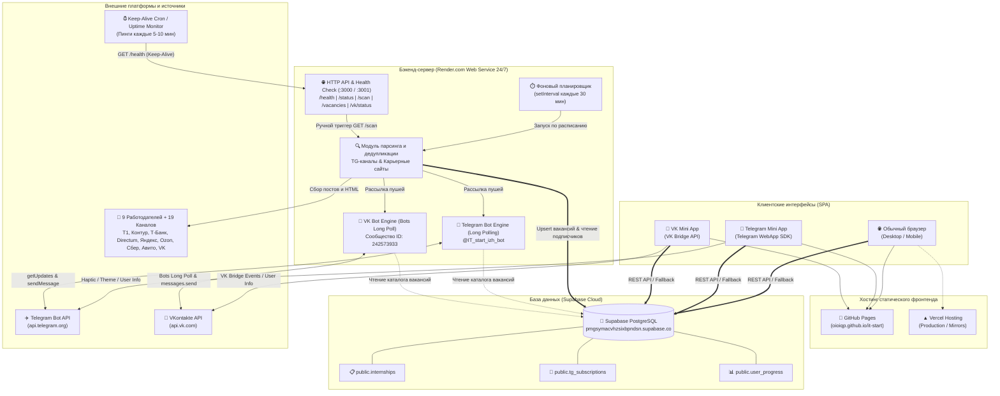

# 🏛️ Архитектура платформы «IT-Старт»

> **Полное техническое описание архитектуры, стека технологий, баз данных, серверных ботов, парсера вакансий, механизмов автопробуждения, хостинга и клиентских приложений.**

---

## 📑 Содержание

1. [Введение и общая архитектура системы](#1-введение-и-общая-архитектура-системы)
2. [Стек технологий и языки: что и для чего использовалось](#2-стек-технологий-и-языки-что-и-для-чего-использовалось)
3. [База данных и модели данных (Supabase / PostgreSQL)](#3-база-данных-и-модели-данных-supabase--postgresql)
4. [Хостинг, CI/CD и инфраструктура деплоя (GitHub Pages, Vercel, Render)](#4-хостинг-cicd-и-инфраструктура-деплоя-github-pages-vercel-render)
5. [Telegram-бот и Telegram Mini App](#5-telegram-бот-и-telegram-mini-app)
6. [ВКонтакте-бот и VK Mini App](#6-вконтакте-бот-и-vk-mini-app)
7. [24/7 Мониторинг вакансий и парсер](#7-247-мониторинг-вакансий-и-парсер)
8. [Автопробуждение (Keep-Alive), Health Check и Dual-Bot Engine](#8-автопробуждение-keep-alive-health-check-и-dual-bot-engine)
9. [Функциональные модули платформы](#9-функциональные-модули-платформы)
10. [Отказоустойчивость, безопасность и обработка сбоев](#10-отказоустойчивость-безопасность-и-обработка-сбоев)
11. [Справочник команд и скриптов запуска](#11-справочник-команд-и-скриптов-запуска)

---

## 1. Введение и общая архитектура системы

Платформа **«IT-Старт»** — это мультиплатформенный сервис профессиональной ориентации, непрерывной агрегации стажировок и Junior-вакансий ведущих IT-компаний России, а также тренажёр для подготовки студентов к техническим собеседованиям.

Проект спроектирован как распределенная отказоустойчивая экосистема, включающая:
- **Единый адаптивный SPA-фронтенд**, работающий как веб-сайт в браузере, а также бесшовно открывающийся как **Telegram Mini App** и **VK Mini App**.
- **Облачную базу данных Supabase (PostgreSQL)** с RLS, структурированными таблицами и многоуровневым in-memory fallback.
- **Серверный бэкенд на Render.com (Node.js)**, объединяющий работу двух автономных ботов (Telegram и VK), HTTP API / Health Check сервер и фоновый планировщик парсинга.
- **24/7 Мониторинг работодателей**, сканирующий 19 Telegram-каналов и официальные сайты карьерных программ 9 ключевых технологических компаний (Холдинг Т1, СКБ Контур, Т-Банк, Directum, Яндекс, Ozon, Сбер, Авито, VK) с автоматической рассылкой пуш-уведомлений подписчикам.
- **Систему автопробуждения (Keep-Alive)**, предотвращающую засыпание бесплатных инстансов на облачных платформах.

### 1.1. Архитектурная диаграмма взаимодействия (Mermaid)



### 1.2. ASCII-схема потоков данных

```text
  +---------------------------------------------------------------------------------+
  |                       ПОЛЬЗОВАТЕЛЬСКИЕ ПЛАТФОРМЫ                                |
  |  [Браузер Chrome/Safari]    [Telegram Mini App]          [VK Mini App]          |
  +--------------------+----------------+---------------------------+---------------+
                       |                |                           |
                       | (Static Assets)| (Telegram WebApp Bridge)  | (VK Bridge)
                       v                v                           v
  +---------------------------------------------------------------------------------+
  |                        ФРОНТЕНД ХОСТИНГ (SPA)                                   |
  |             GitHub Pages (https://oioiqp.github.io/it-start/)                   |
  |             Vercel Hosting (https://<project-name>.vercel.app)                  |
  +--------------------+------------------------------------------------------------+
                       |
                       | Чтение вакансий, сохранение прогресса роадмапов
                       v
  +---------------------------------------------------------------------------------+
  |                  ОБЛАЧНАЯ БАЗА ДАННЫХ (SUPABASE POSTGRESQL)                     |
  |  - public.internships     : Актуальные стажировки 9 работодателей               |
  |  - public.tg_subscriptions: Подписчики на уведомления по направлениям          |
  |  - public.user_progress   : Прогресс чек-листов и вопросов пользователей        |
  +--------------------+------------------------------------------------------------+
                       ^
                       | Синхронизация новых вакансий & чтение подписчиков
                       v
  +---------------------------------------------------------------------------------+
  |             БЭКЕНД И БОТЫ (RENDER.COM 24/7 WEB SERVICE)                         |
  |  Node.js (ES Modules) -> https://it-start-bot.onrender.com                      |
  |                                                                                 |
  |  +------------------------+  +----------------------+  +---------------------+  |
  |  |   Telegram Bot         |  |   VKontakte Bot      |  |   HTTP & Health     |  |
  |  |   Long Polling Engine  |  |   Bots Long Poll     |  |   Check Сервер      |  |
  |  |   @IT_start_izh_bot    |  |   ID: 242573933      |  |   (Порты 3000/3001) |  |
  |  +------------------------+  +----------------------+  +---------------------+  |
  |              ^                           ^                        ^             |
  |              |                           |                        |             |
  |  +---------------------------------------------------+            | Keep-Alive  |
  |  |   24/7 Парсер и фоновый планировщик (каждые 30м)   |            | Пинги       |
  |  |   - Сбор постов из 19 карьерных TG-каналов        |            | (5-10 мин)  |
  |  |   - Парсинг официальных карьерных сайтов          |            |             |
  |  |   - Дедупликация, Upsert в Supabase               |            |             |
  |  |   - Параллельная рассылка персональных пушей     |            |             |
  |  +---------------------------------------------------+            |             |
  +-------------------------------------------------------------------+-------------+
                                                                      ^
                                 Внешние сервисы пинга (UptimeRobot / Cron-Job) -----+
```

---

## 2. Стек технологий и языки: что и для чего использовалось

Архитектурный принцип проекта — **максимальная производительность, строгая типизация, отсутствие избыточных тяжелых библиотек и высокая скорость отклика**.

| Уровень системы | Технология / Библиотека | Назначение и обоснование выбора |
| :--- | :--- | :--- |
| **Frontend UI** | **TypeScript 6** | Строгая типизация моделей данных (`Internship`, `RoadmapTopic`, `Question`, `TelegramSubscription`), гарантирующая отсутствие runtime-ошибок при работе со сложными структурами. |
| **Frontend Core** | **React 19** | Новейшая версия библиотеки: оптимизированный рендеринг компонентов, поддержка актуальных стандартов хуков, стабильная интеграция с WebApp SDK и VK Bridge. |
| **Frontend Сборка** | **Vite 8** | Сверхбыстрый dev-сервер с Hot Module Replacement (HMR) и оптимизированная сборка статического продакшн-бандла с поддержкой динамического базового пути (`base`). |
| **Стилизация** | **Tailwind CSS v4** | Новая спецификация `@import "tailwindcss"`: компиляция стилей на лету, CSS-переменные, нулевой оверхед рантайма. |
| **Дизайн-система** | **Liquid Matte Glass** | Премиальный визуальный стиль в духе Apple macOS/iOS: многослойное матовое стекло (`backdrop-filter: blur(40px)`), сквирклы (`rounded-[28px]`), спокойный титаново-жемчужный фон (`#ccd3e0`), идеальный контраст текста и тактильные микроанимации нажатий. |
| **Иконки & Эффекты** | **lucide-react & canvas-confetti** | Современный легковесный набор SVG-иконок и салют из конфетти при завершении этапов роадмапа и прохождении самопроверки. |
| **Backend & Скрипты** | **Node.js (ES Modules)** | Единый язык JavaScript/TypeScript на всем стеке. Нативный `fetch` без Axios, нативный `node:http`, нулевые внешние зависимости для ботов. |
| **Telegram Bot API** | **Нативный HTTP Long Polling** | Надежный протокол постоянного опроса очереди `getUpdates` с автоматическим переподключением при сетевых задержках и обработкой команд. |
| **VK Bot API** | **VK Bots Long Poll API (v5.199)** | Официальный серверный протокол ВКонтакте для мгновенного получения входящих сообщений сообщества через `groups.getLongPollServer`. |
| **База данных** | **Supabase (PostgreSQL 15)** | Облачный PostgreSQL с готовым REST API через `@supabase/supabase-js`, поддержкой RLS и Upsert-операций. |
| **Тестирование** | **Vitest 5 + happy-dom** | Быстрый набор из **45 автоматических тестов**, покрывающий 100% бизнес-требований проекта (от валидации конфигураций до эмуляции команд ботов). |
| **Линтинг** | **Oxlint** | Сверхбыстрый Rust-линтер кода нового поколения, обеспечивающий чистоту исходных файлов. |

---

## 3. База данных и модели данных (Supabase / PostgreSQL)

В качестве основного хранилища данных используется облачный кластер **Supabase**:
- **Project URL:** `https://pmgsymacvhzsixbpndsn.supabase.co`
- **Протокол доступа:** HTTPS REST API через официальный клиент `@supabase/supabase-js`.
- **Клиентский модуль:** [`src/lib/supabase.ts`](file:///c:/Projects/code/v_c/IT%20Start/src/lib/supabase.ts).

### 3.1. Структура таблиц базы данных

#### 1. Таблица `public.internships` (Каталог стажировок и вакансий)
Хранит все актуальные позиции, найденные парсером или добавленные вручную.
```sql
CREATE TABLE public.internships (
    id TEXT PRIMARY KEY,                       -- Уникальный идентификатор вакансии
    title TEXT NOT NULL,                       -- Название вакансии (напр. "Стажёр Frontend-разработчик")
    company TEXT NOT NULL,                     -- Название работодателя ("Т-Банк", "Холдинг Т1", "Контур"...)
    company_logo TEXT,                         -- URL логотипа компании
    direction TEXT NOT NULL,                   -- Идентификатор направления: frontend, backend, mobile, data_science, qa, devops
    sub_track TEXT NOT NULL,                   -- Специализация: react, golang, python, android, manual_qa...
    format TEXT NOT NULL DEFAULT 'Удаленно',  -- Формат: Удаленно, Гибрид, Офис
    city TEXT DEFAULT 'Москва / Удаленно',     -- Локация офиса / регион стажировки
    salary TEXT DEFAULT 'По договоренности',  -- Зарплатная вилка
    source_type TEXT DEFAULT 'telegram',       -- Источник: telegram | portal
    source_name TEXT NOT NULL,                 -- Имя канала или сайта (напр. @t1career или kontur.ru/career)
    source_url TEXT NOT NULL,                  -- Прямая ссылка для отклика на стажировку
    description TEXT,                          -- Подробное описание программы стажировки
    tags JSONB DEFAULT '[]'::jsonb,            -- Стек технологий и ключевые метки
    requirements JSONB DEFAULT '[]'::jsonb,    -- Требования к кандидату
    responsibilities JSONB DEFAULT '[]'::jsonb,-- Обязанности стажёра
    is_hot BOOLEAN DEFAULT false,              -- Отметка горячей/срочной вакансии
    published_at TIMESTAMPTZ DEFAULT now()     -- Время публикации/обнаружения
);
```

#### 2. Таблица `public.tg_subscriptions` (Подписчики ботов)
Хранит профили пользователей, оформивших подписку на уведомления в Telegram или VK.
```sql
CREATE TABLE public.tg_subscriptions (
    chat_id TEXT PRIMARY KEY,                  -- ID чата Telegram или ID пользователя VK
    username TEXT,                             -- Никнейм пользователя (@username)
    first_name TEXT,                           -- Имя пользователя
    directions JSONB DEFAULT '[]'::jsonb,      -- Выбранные общие направления для пушей
    sub_tracks JSONB DEFAULT '[]'::jsonb,      -- Конкретные технологические стеки
    is_active BOOLEAN DEFAULT true,            -- Флаг активности подписки
    updated_at TIMESTAMPTZ DEFAULT now()       -- Дата последнего обновления настроек
);
```

#### 3. Таблица `public.user_progress` (Прогресс обучения пользователей)
Хранит персональный прогресс прохождения интерактивных роадмапов и подготовки к вопросам.
```sql
CREATE TABLE public.user_progress (
    user_key TEXT PRIMARY KEY,                 -- ID пользователя (Telegram User ID / VK User ID / Local Key)
    completed_nodes JSONB DEFAULT '[]'::jsonb, -- Завершенные родительские темы роадмапа
    completed_questions JSONB DEFAULT '[]'::jsonb, -- Освоенные вопросы из базы собеседований
    saved_internships JSONB DEFAULT '[]'::jsonb,   -- Избранные стажировки
    updated_at TIMESTAMPTZ DEFAULT now()       -- Дата последней синхронизации прогресса
);
```

### 3.2. Архитектура отказоустойчивости (Safe In-Memory & Offline Fallback)

Платформа спроектирована по принципу **Graceful Degradation (элегантной деградации)**:
1. **Быстрый таймаут сетевого запроса (`quickFetch`):** 
   В `src/lib/supabase.ts` стандартный `fetch` обернут в `AbortController` с жестким ограничением в **1200 мс**. Если облачный сервис Supabase отвечает медленно или временно недоступен из-за сетевой блокировки, запрос мгновенно прерывается, не подвешивая интерфейс приложения.
2. **Безопасные In-Memory хранилища:**
   При сбое сети модуль автоматически переключается во внутренний режим:
   ```typescript
   let isSupabaseOffline = isTestEnv;
   const inMemoryInternships: Map<string, Internship> = new Map();
   const inMemorySubscriptions: Map<string, TelegramSubscription> = new Map();
   const inMemoryUserProgress: Map<string, UserProgress> = new Map();
   ```
   Это гарантирует:
   - Моментальный запуск и стабильный прогон 45 автоматических тестов без обращения к внешнему серверу.
   - Бесперебойную работу интерфейса даже при нулевом подключении к сети.
3. **Двухуровневое кэширование в `localStorage`:**
   Все загруженные вакансии, подписки и прогресс сохраняются в браузере пользователя через [`src/lib/storage.ts`](file:///c:/Projects/code/v_c/IT%20Start/src/lib/storage.ts). Даже при полном отсутствии интернета пользователь может комфортно изучать темы роадмапа и тренировать карточки вопросов.

---

## 4. Хостинг, CI/CD и инфраструктура деплоя (GitHub Pages, Vercel, Render)

Архитектура разделена на два независимых контура: **статический фронтенд** и **вычислительный бэкенд 24/7**.

```text
               +---------------------------------------------------+
               |             GitHub Репозиторий                    |
               |             github.com/oioiqp/it-start            |
               +-------------------------+-------------------------+
                                         |
                                         +-----------------------------------------+
                                         | git push main                           |
                                         v                                         v
               +-----------------------------------+     +-----------------------------------+
               |    GitHub Actions (.github)       |     |     Vercel Auto-Deployment        |
               |  1. npm ci                        |     |  - Root Path: /                   |
               |  2. npm test (45 тестов)          |     |  - Rewrites: vercel.json          |
               |  3. npm run build                 |     |  - Build: tsc -b && vite build    |
               |  4. .nojekyll & dist/404.html     |     |  - Preview & Production URL       |
               |  5. Deploy в ветку gh-pages       |     +-----------------------------------+
               +-----------------+-----------------+
                                 |
                                 v
                     +--------------------------------------+
                     |      GitHub Pages (Продакшн SPA)     |
                     |   https://oioiqp.github.io/it-start/ |
                     +--------------------------------------+
                                         |
             +---------------------------+---------------------------+
             |                                                       |
             v                                                       v
+--------------------------------+              +--------------------------------+
|  Telegram Mini App Контекст    |              |     VK Mini App Контекст       |
|  (Открывается внутри @Bot)     |              |  (Открывается внутри VK App)   |
+--------------------------------+              +--------------------------------+
```

### 4.1. GitHub как единый источник правды
Репозиторий `oioiqp/it-start` хранит весь исходный код: клиентскую часть, серверные боты, тесты и конфигурации деплоя.

### 4.2. Фронтенд-хостинг: GitHub Pages & Vercel
Приложение разработано с универсальной поддержкой обоих популярных статических хостингов:

1. **GitHub Pages (основной хостинг):**
   - Рабочий адрес: `https://oioiqp.github.io/it-start/`.
   - Автоматический деплой настроен через `.github/workflows/deploy.yml`.
   - Так как GitHub Pages размещает проект в поддиректории `/it-start/`, в конфигурации `vite.config.ts` по умолчанию используется базовый путь `/it-start/`.
   - Для поддержки SPA-роутинга скрипт `scripts/postbuild.cjs` копирует `index.html` в `dist/404.html`, а рабочий процесс создает маркер `.nojekyll`.

2. **Vercel (Production / Mirrors):**
   - Проект полностью готов к деплою на Vercel (через подключение репозитория GitHub или CLI `vercel`).
   - В корне проекта создан конфигурационный файл [`vercel.json`](file:///c:/Projects/code/v_c/IT%20Start/vercel.json):
     ```json
     {
       "rewrites": [
         {
           "source": "/(.*)",
           "destination": "/index.html"
         }
       ]
     }
     ```
   - В [`vite.config.ts`](file:///c:/Projects/code/v_c/IT%20Start/vite.config.ts) реализовано автоматическое определение среды Vercel:
     ```typescript
     base: process.env.VITE_BASE_PATH || (process.env.VERCEL ? '/' : '/it-start/'),
     ```
     При сборке на Vercel переменная `process.env.VERCEL` выставляет базовый путь `/`, исключая ошибки загрузки скриптов и обеспечивая корректное открытие любых URL без 404 ошибок.

### 4.3. Бэкенд-хостинг: Render.com Web Service (24/7)
- **URL бэкенда:** `https://it-start-bot.onrender.com`
- **Тип инстанса:** Render Web Service (Node.js).
- **Команда сборки (Build Command):** `npm install`
- **Команда запуска (Start Command):** `npm run bot:all`
- **Переменные окружения (Environment Variables):**
  - `TELEGRAM_BOT_TOKEN` — токен Telegram-бота от BotFather.
  - `VK_BOT_TOKEN` — ключ доступа сообщества ВКонтакте.
  - `VK_GROUP_ID` — ID сообщества (`242573933`).
  - `PORT` — порт HTTP Health Check сервера (`3000`).

---

## 5. Telegram-бот и Telegram Mini App

Telegram-экосистема платформы состоит из двух частей: сервера бота и клиентского Mini App интерфейса.

### 5.1. Telegram-бот (`bot/bot.mjs`)
- **Имя бота:** [@IT_start_izh_bot](https://t.me/IT_start_izh_bot)
- **Архитектура:** Чистый Node.js без внешних библиотек (Telegraf, node-telegram-bot-api не требуются). Используется нативный `fetch` и протокол **Long Polling** (`getUpdates` с таймаутом 25 сек).
- **Основные команды:**
  - `/start` — приветственное сообщение с инлайн-клавиатурой и кнопкой запуска Mini App.
  - `/vacancies` — каталог стажировок с интерактивным выбором направлений (Frontend, Backend, Mobile, Data Science, QA, DevOps).
  - `/companies` — карточки 9 ключевых работодателей с их описанием и открытыми позициями.
  - `/roadmaps` — быстрый доступ к картам развития.
  - `/questions` — вопросы с собеседований с фильтрацией по уровням.
  - `/subscribe` — оформление подписки на автоматические пуш-уведомления.
  - `/status` — аптайм сервера, количество проверенных каналов и сайтов, статистика последнего прогона парсера.
  - `/help` — подробная справка по командам.
- **Умный поиск вакансий по тексту:**
  Если пользователь пишет боту обычный текст (например: *«покажи вакансии контура»*, *«яндекс»*, *«т1»*, *«стажировка в директум»*), бот автоматически распознает компанию через функцию `findCompanyByQuery()` и возвращает актуальный список стажировок.

### 5.2. Интеграция Telegram Mini App (`src/lib/telegram.ts`)
- **Запуск внутри Telegram:** В `index.html` подключен официальный скрипт `https://telegram.org/js/telegram-web-app.js`.
- **Автоматическая адаптация:** При открытии приложения внутри мессенджера:
  1. Вызывается `window.Telegram.WebApp.ready()` для синхронизации с клиентом.
  2. Вызывается `window.Telegram.WebApp.expand()` для раскрытия на весь экран смартфона.
  3. Извлекаются безопасные данные текущего пользователя (`WebApp.initDataUnsafe.user`) для персонализации.
  4. Активируется **Haptic Feedback (тактильный отклик)**: легкая вибрация при выборе фильтров (`impactOccurred('light')`), переключении чекбоксов роадмапа и салюте конфетти (`notificationOccurred('success')`).

---

## 6. ВКонтакте-бот и VK Mini App

Сервис полностью адаптирован под российскую социальную сеть ВКонтакте, предоставляя сообществу аналогичный функционал.

### 6.1. Серверный VK-бот (`bot/vk_bot.mjs`)
- **Официальное сообщество:** [club242573933 («IT старт»)](https://vk.com/club242573933)
- **Прямая ссылка на диалог:** [vk.com/im?sel=-242573933](https://vk.com/im?sel=-242573933)
- **Протокол:** **Bots Long Poll API** (версия API `5.199`).
  1. Бот запрашивает параметры сессии через `groups.getLongPollServer`.
  2. Подключается к выделенному серверу событий ВКонтакте с `wait: 25`.
  3. При получении события `message_new` обрабатывает команды и текст.
- **Интерактивная клавиатура:**
  Используется официальная клавиатура ВКонтакте (`one_time: false`):
  - Кнопки быстрого вызова: `Стажировки`, `Компании`, `Роадмапы`, `Вопросы`, `Подписка`, `Статус`.
  - Кнопка со ссылкой: `🚀 Открыть IT-Старт`.
- **Автозагрузка секретов:** 
  Функция `autoLoadEnv()` сканирует пути `.env` в корне проекта и в папке `bot/`, автоматически заполняя переменные `VK_BOT_TOKEN`, `VK_GROUP_ID` без необходимости ручного экспорта в shell.
- **Безопасный Fallback-режим:**
  При локальной разработке или запуске без токена бот не завершает процесс ошибкой, а переходит в демонстрационный режим, логируя события и позволяя фронтенду тестировать функционал.

### 6.2. Адаптер VK Mini App (`src/lib/vkBridge.ts`)
- **Детекция среды запуска:** Модуль автоматически анализирует URL на наличие параметров запуска `vk_*` (поддерживается как query-строка, так и hash-роутинг SPA).
- **Парсинг параметров запуска:**
  - `vk_user_id` — ID пользователя ВКонтакте.
  - `vk_app_id` — ID зарегистрированного приложения.
  - `vk_platform` — платформа (`mobile_web`, `desktop_web`, `mobile_android`, `mobile_iphone`).
  - `sign` — цифровая подпись запроса для валидации на бэкенде.
- **VK Bridge события:** 
  Безопасный вызов `VKWebAppInit`, получение профиля через `VKWebAppGetUserInfo` и тактильная отдача на мобильных устройствах через `VKWebAppTapticImpactOccurred`.

---

## 7. 24/7 Мониторинг вакансий и парсер

Парсер обеспечивает непрерывную агрегацию свежих предложений без участия человека.

### 7.1. Отслеживаемые работодатели, Telegram-каналы и сайты

Система ведет непрерывный мониторинг 19 Telegram-каналов (15 каналов работодателей + 4 агрегатора) и официальных карьерных сайтов 9 крупнейших технологических компаний:

| Компания | Telegram-каналы из `ALL_TARGET_TG_CHANNELS` | Официальные карьерные порталы (`CAREER_WEBSITES_DATA`) |
| :--- | :--- | :--- |
| **Холдинг Т1** | `@t1career` (Открытая школа Т1), `@t1_holding` | `https://career.t1.ru` |
| **СКБ Контур** | `@KonturTech` (Технологии), `@kontur_career` | `https://kontur.ru/career/vacancies` (Контур.Старт) |
| **Т-Банк** | `@tbank_team`, `@tbank_career`, `@tinkoff_jobs` | `https://tbank.ru/career/it/` (Финтех-стажировки) |
| **Directum (Ижевск)** | `@Life_in_Directum`, `@directum_career` | `https://career.directum.ru/vacancy` (Directum RX) |
| **Яндекс** | `@yandex_intern` (Интерны), `@yandex` | `https://yandex.ru/yandex-intern` (Young Con) |
| **Ozon** | `@ozon_tech_career` (Ozon Tech Career) | `https://job.ozon.ru` (Ozon Camp) |
| **Сбер** | `@sber_careers` (Сбер Карьера & AI) | `https://sbergraduate.ru` (Sberseasons) |
| **Авито** | `@avito_tech` (Avito Tech Jobs) | `https://career.avito.com` |
| **VK** | `@vk_team` (Карьера в VK) | `https://internship.vk.company` (Программа стажировок) |
| **Агрегаторы** | `@forjunior`, `@it_internships`, `@normrabota`, `@tproger_jobs` | Каталоги стажировок для Junior & Trainee |

### 7.2. Логика работы парсера (`scanChannelsAndSyncSupabase`)

```text
[Таймер: каждые 30 минут / HTTP GET /scan]
                     │
                     ▼
┌────────────────────────────────────────────────────────┐
│  Параллельный сбор данных (Promise.allSettled)         │
│  - Сбор постов из 19 Telegram-каналов                  │
│  - Сканирование страниц карьерных программ             │
└────────────────────┬───────────────────────────────────┘
                     │
                     ▼
┌────────────────────────────────────────────────────────┐
│  Нормализация и извлечение сущностей                   │
│  - Определение направления (frontend, backend...)      │
│  - Определение подтрека (react, golang, python...)     │
│  - Выделение формата (Удаленно / Гибрид / Офис)        │
│  - Извлечение вилки зарплаты и тегов                   │
└────────────────────┬───────────────────────────────────┘
                     │
                     ▼
┌────────────────────────────────────────────────────────┐
│  Умная двухфакторная дедупликация                      │
│  - Проверка уникальности по id (Set seenIds)           │
│  - Проверка уникальности по ключу: company + title     │
│  - Отсечение ранее сохраненных позиций                 │
└────────────────────┬───────────────────────────────────┘
                     │
                     ▼
┌────────────────────────────────────────────────────────┐
│  Пакетное сохранение в Supabase                        │
│  - supabase.from('internships').upsert(rows)           │
│  - Сброс серверного кэша активных вакансий             │
└────────────────────┬───────────────────────────────────┘
                     │
                     ▼
┌────────────────────────────────────────────────────────┐
│  Таргетированная рассылка пушей подписчикам            │
│  - Чтение подписчиков из public.tg_subscriptions       │
│  - Фильтрация по совпадающим направлениям/стекам       │
│  - Отправка пуша в Telegram (@IT_start_izh_bot)       │
│  - Отправка пуша в личные сообщения ВКонтакте          │
│  - Защита от дублей уведомлений (Set: chat_id + id)    │
└────────────────────────────────────────────────────────┘
```

---

## 8. Автопробуждение (Keep-Alive), Health Check и Dual-Bot Engine

### 8.1. Проблема бесплатного тарифа Render.com
Бесплатные инстансы (Free Web Services) на Render.com автоматически переходят в спящий режим (Spin-down) после 15 минут отсутствия входящих HTTP-запросов. Если сервер засыпает:
- фоновый таймер Node.js (`setInterval`) замораживается;
- Long Polling ботов прерывается;
- боты перестают отвечать на сообщения пользователей до первого нового внешнего HTTP-запроса.

### 8.2. Встроенный HTTP-сервер
Для решения этой проблемы в бэкенд интегрирован легковесный HTTP-сервер на нативном модуле `node:http`:
- Основной порт: `3000` (для Telegram-бота или единого режима `bot:all`).
- Дополнительный порт: `3001` (для изолированного запуска VK-бота).
- Обрабатываемые маршруты:
  - `GET /` — текстовый пинг (200 OK: `"IT-Старт Telegram & VK Bot & Parser работает 24/7! (Render Health Check OK)"`).
  - `GET /health` — структурированный JSON со статусом здоровья, аптаймом, счетчиками источников и метриками последнего сканирования:
    ```json
    {
      "status": "ok",
      "uptime": 1420.5,
      "bot": "IT_start_izh_bot",
      "channelsCount": 19,
      "websitesCount": 9,
      "lastScan": { ... }
    }
    ```
  - `GET /status` — полная аналитика состояния ботов, работодателей и базы вакансий.
  - `GET /scan` (алиасы `/parse`, `/sync`) — принудительный веб-хук триггер сканирования источников без ожидания 30-минутного таймера.
  - `GET /vacancies` — выдача актуальных вакансий в формате JSON.
  - `GET /vk/status` — текущий статус подключения VK-бота.

### 8.3. Внешний контур Keep-Alive (Автопробуждение)
Для предотвращения засыпания сервера настраивается внешний пингер:
- **Сервисы:** Cron-Job.org, UptimeRobot, BetterStack или GitHub Actions Scheduled Curl.
- **Целевой URL:** `https://it-start-bot.onrender.com/health`
- **Метод:** `GET`
- **Интервал:** Каждые **5–10 минут** (гарантированно меньше 15 минут таймаута Render).
- **Результат:**
  - Render постоянно видит входящий трафик и **никогда не усыпляет сервис**.
  - Telegram Long Polling и VK Bots Long Poll непрерывно слушают события.
  - Фоновый планировщик каждые 30 минут автоматически сканирует каналы и рассылает пуши.

### 8.4. Dual-Bot Runner (`bot:all`)
Для оптимизации ресурсов оба бота могут запускаться в **едином Node.js процессе**:
```bash
npm run bot:all
```
В файле `bot/bot.mjs` при наличии флага `--all` или токена ВКонтакте происходит динамический импорт `bot/vk_bot.mjs` и запуск `startVkBot()`. В результате оба бота (Telegram и VK) работают параллельно на одном инстансе, делят общий кэш вакансий и слушают единый HTTP-порт `3000`.

---

## 9. Функциональные модули платформы

### 9.1. Агрегатор стажировок с расчетом готовности
- **Многоуровневая фильтрация:** мгновенная фильтрация по тексту, компании, направлению (6 направлений), технологическому подтреку, формату работы (Удаленно/Гибрид/Офис) и источнику.
- **Динамический расчет готовности студента (`%`):** для каждой вакансии алгоритм сопоставляет требуемый стек с пройденными темами в профиле пользователя и отображает прогресс-бар готовности к отклику.
- **Модальное окно «План подготовки» ([`src/components/InternshipModal.tsx`](file:///c:/Projects/code/v_c/IT%20Start/src/components/InternshipModal.tsx)):** при клике на вакансию генерируется пошаговый чек-лист тем роадмапа и персональный список вопросов к собеседованию.

### 9.2. Интерактивные роадмапы (6 направлений)
База знаний охватывает 6 ключевых сфер разработки:
1. **Frontend-разработка:** Core (сеть, CRP, JS Event Loop, TypeScript) + ветки React, Angular, Vue.js.
2. **Backend-разработка:** Core (REST, ACID, PostgreSQL, Docker, Redis) + ветки Python, Go (Golang), Java, Node.js.
3. **Mobile-разработка:** Core (MVVM, Clean Arch, Main Thread) + ветки Android (Kotlin), iOS (Swift), Flutter.
4. **Data Science, ML & Аналитика:** Core (тервер, матстат, SQL) + ветки ML Engineer, Data Analyst.
5. **QA (Тестирование ПО):** Core (тест-дизайн, Postman, клиент-сервер) + ветки Manual QA, QA Automation.
6. **DevOps & Cloud:** Core (Linux, Bash, Nginx, сети) + ветки CI/CD & Docker, Kubernetes & IaC.

**Двусторонняя синхронизация подтем (Two-Way Sync):**
В [`src/App.tsx`](file:///c:/Projects/code/v_c/IT%20Start/src/App.tsx) и [`src/components/RoadmapViewer.tsx`](file:///c:/Projects/code/v_c/IT%20Start/src/components/RoadmapViewer.tsx) реализован строгий алгоритм синхронизации:
- Отметка родительской темы (`handleToggleTopic`) автоматически отмечает все её вложенные подтемы (`topicId__sub_${idx}`).
- Отметка всех подтем (`handleToggleSubtopic`) автоматически переводит родительскую тему в статус освоенной с анимацией конфетти (`canvas-confetti`).
- Снятие галочки с любой подтемы корректно снимает статус завершенности с родительской темы.

### 9.3. Тренажёр собеседований (55+ вопросов)
Включает три взаимодополняющих режима подготовки:
1. **Каталог с разбором ([`src/components/QuestionsViewer.tsx`](file:///c:/Projects/code/v_c/IT%20Start/src/components/QuestionsViewer.tsx)):** глубокие ответы, практические антипаттерны, критерии оценки интервьюером и блоки кода с подсветкой.
2. **Тренажёр флеш-карточек ([`src/components/FlashcardsTrainer.tsx`](file:///c:/Projects/code/v_c/IT%20Start/src/components/FlashcardsTrainer.tsx)):** режим интервальной симуляции. Пользователь видит вопрос, формулирует ответ, переворачивает карточку и маркирует знание («Знаю» / «Повторить»).
3. **Тренажёр самопроверки ([`src/components/SelfCheckTrainer.tsx`](file:///c:/Projects/code/v_c/IT%20Start/src/components/SelfCheckTrainer.tsx)):** продвинутый тренажёр с рукописным вводом ответа в текстовое поле, сравнением с эталонным решением, подсчетом набранных баллов и салютом конфетти по завершении сессии.

### 9.4. Вкладка управления ботами и мониторинга ([`src/components/TelegramParserTab.tsx`](file:///c:/Projects/code/v_c/IT%20Start/src/components/TelegramParserTab.tsx))
Инженерная панель прямо в интерфейсе:
- Живой мониторинг статуса Telegram-каналов и карьерных порталов.
- Тестирование отправки реальных пушей в Telegram и ВКонтакте.
- Интерактивная консоль логирования (Terminal Logs).
- Форма ручной публикации вакансий с валидацией ссылок через [`src/lib/vacancyUrl.ts`](file:///c:/Projects/code/v_c/IT%20Start/src/lib/vacancyUrl.ts).

---

## 10. Отказоустойчивость, безопасность и обработка сбоев

1. **Безопасность токенов и секретов:**
   - Ни один приватный токен бота (`TELEGRAM_BOT_TOKEN`, `VK_BOT_TOKEN`) не зашит в клиентский JavaScript-код.
   - На бэкенде токены загружаются исключительно через переменные окружения сервера или локальные файлы `.env`, добавленные в `.gitignore`.
   - В клиентском веб-интерфейсе токены для тестирования хранятся исключительно в изолированном `localStorage` браузера пользователя.
2. **Защита от сетевых сбоев и тайм-аутов:**
   - Сетевые запросы защищены таймаутами через `AbortController` (1200 мс).
   - При сбое соединения со сторонними сервисами интерфейс мгновенно переходит на локальные seed-данные без белых экранов и блокировки UI.
3. **Безопасная обработка ссылок:**
   - Модуль `vacancyUrl.ts` нормализует все ссылки работодателей, гарантируя корректное открытие карьерных страниц и исключая XSS-уязвимости.

---

## 11. Справочник команд и скриптов запуска

```bash
# ==========================================
# 1. Установка зависимостей
# ==========================================
npm install

# ==========================================
# 2. Локальная разработка веб-интерфейса
# ==========================================
npm run dev

# ==========================================
# 3. Запуск автоматических тестов (Vitest)
# ==========================================
npm run test

# ==========================================
# 4. Проверка чистоты кода (Oxlint)
# ==========================================
npm run lint

# ==========================================
# 5. Сборка продакшн-бандла для деплоя
# ==========================================
npm run build

# ==========================================
# 6. Запуск ботов на сервере
# ==========================================
# Только Telegram-бот + HTTP сервер
TELEGRAM_BOT_TOKEN="ВАШ_ТОКЕН" npm run bot

# Только ВКонтакте-бот + HTTP сервер
VK_BOT_TOKEN="ВАШ_ТОКЕН_ГРУППЫ" npm run bot:vk

# Одновременный запуск обоих ботов (Production 24/7)
TELEGRAM_BOT_TOKEN="ТОКЕН_TG" VK_BOT_TOKEN="ТОКЕН_VK" npm run bot:all
```

---

*Документ составлен для проекта IT-Старт (репозиторий `oioiqp/it-start`).*
